# 1. Project Overview and Implementation Status

Budget Buddy is a personal finance assistant for a single user. The user imports bank CSV exports (TD, RBC, or a generic layout). The application categorizes transactions, tracks monthly budgets and savings goals, reports spending trends, and answers questions in plain language. It runs as a JavaFX desktop GUI and as a picocli command-line interface. Both interfaces call the same `BudgetBuddyFacade`. Data is stored locally in SQLite.

The AI component is Claude, accessed through the Anthropic API via `ClaudeAdapter`. The LLM is used in three ways:

- **Categorization (F02):** the LLM labels transactions that the merchant rules do not cover. Its JSON reply is validated before use.
- **Agent behavior (F09, F11):** a tool-using agent loop (`BudgetBuddyAgent`) lets the LLM call spending, budget, and goal tools over several steps, with conversation memory, to answer questions and write a saving plan.
- **Explanation and labeling (F07, F08, F10):** the LLM names recurring subscriptions, explains unusual expenses, and writes the monthly recap. Java computes the underlying facts first.

If no API key is configured, the application runs with rules-only categorization and an offline assistant. Mock and offline paths are covered by unit tests.

**Implementation status:** all eleven Stage 1 features (F01 to F11) are implemented and reachable from both the GUI and the CLI.

**Limitations and incomplete work:**

- The full deterministic test suite and KUMA agent validation are Stage 3 work. Stage 2 includes only basic verification (Section 6).
- AI-assisted features need a live API key, and their output can differ between runs.
- CSV import supports only the TD, RBC, and generic layouts.
- The AI saving plan (F11) can return an incomplete answer. The agent sometimes exhausts its 6-step limit while querying spending, and the app then shows a step-limit message instead of a plan. The plan prompt does not include today's date, so the model can choose a month with no data.
- Savings goals and transactions cannot be edited or deleted in the GUI. Budgets and goals cannot be edited in place. Test data was cleared by resetting the local database.
- The GUI has minimal empty-state guidance. With no API key, Ask (F09) shows an "assistant offline" banner and reply. With an invalid key, the GUI does not clearly report the failure, so it can look like an empty reply until checked in the CLI.
- The F09 Ask answer can name the wrong year. In one run it mentioned October 2024 while reporting October 2026, which points to the prompt not including today's date. The same gap affects F11 (see below).
- The required monthly amount for a goal counts whole months from the current month to the deadline month, so contributions in the current month are not included.

# 2. Feature to Implementation Mapping

Stage 1 details are in `docs/Stage1_Report.md`. All features keep their Stage 1 IDs and names.

| Feature | Stage 1 ref. | Status | Classes and files | Key methods | Patterns | Video |
|---|---|---|---|---|---|---|
| F01 Import transactions | F01 | Implemented | `ImportService`, `TransactionsController`, `BudgetBuddyCli`, `BudgetBuddyFacade` | `importFile()`, `parseRow()`, `importTransactions()` | Facade, MVC | [F01](https://drive.google.com/file/d/1edJRtekiVCy1tNSHZtkapC8zIw6ISOwF/view?usp=drive_link) |
| F02 AI auto-categorization | F02 | Implemented (hybrid) | `CategorizationService`, `CategorizationStrategy`, `RuleBasedStrategy`, `AiAssistedStrategy`, `PromptBuilder`, `ClaudeAdapter` | `categorize()`, `categorizeUncategorized()`, `categorizePrompt()`, `complete()` | Strategy, Adapter | [F02](https://drive.google.com/file/d/1mmB7g29cfgacoRwTIsPxu5ploezEjeQd/view?usp=drive_link) |
| F03 Category correction and learning | F03 | Implemented (hybrid) | `CategorizationService`, `CategoryRuleRepository`, `BudgetBuddyFacade`, `TransactionsController` | `correctCategory()`, `setCategory()`, `save()` | Facade, Strategy | [F03](https://drive.google.com/file/d/1VnK_T5DSReParZvzGUhb4vScgT2HXuUe/view?usp=drive_link) |
| F04 Budget management | F04 | Implemented | `BudgetService`, `BudgetRepository`, `Budget`, `BudgetsGoalsController`, `BudgetBuddyFacade` | `saveBudget()`, `deleteBudget()`, `copyBudgets()` | Facade, MVC | [F04](https://drive.google.com/file/d/12HoTtHiatxse6n-DuCJNfGgts0wKkDm8/view?usp=drive_link) |
| F05 Budget tracking and alerts | F05 | Implemented | `BudgetService`, `BudgetAlertListener`, `GuiBudgetAlertListener`, `BudgetBuddyCli` | `recalculate()`, `notifyListeners()`, `onBudgetAlert()` | Observer | [F05](https://drive.google.com/file/d/14fdMME_70fTajs-fI3orGKiu19BqT6aZ/view?usp=drive_link) |
| F06 Spending trends | F06 | Implemented | `AnalyticsService`, `InsightsController`, `InsightsLogic`, `MonthlySummary` | `getTrends()`, `getSpendingTrends()` | Facade, MVC | [F06](https://drive.google.com/file/d/1PRUUtAXOKR_kUGtTG6PhCdF67fk8r4co/view?usp=drive_link) |
| F07 Recurring payments | F07 | Implemented (hybrid) | `AnalyticsService`, `RecurringPayment`, `BudgetBuddyAgent` | `detectRecurring()`, `labelSubscriptions()` | Facade, Adapter | [F07](https://drive.google.com/file/d/14EzGuTKlZy-7jtr5Va4UtqXCCS-VBy4W/view?usp=drive_link) |
| F08 Unusual expenses | F08 | Implemented (hybrid) | `AnalyticsService`, `Anomaly`, `BudgetBuddyAgent` | `detectUnusual()`, `explainAnomalies()` | Facade, Adapter | [F08](https://drive.google.com/file/d/1xDQFumH5AUeYzkWPH0XtSIQeP9P4m8tE/view?usp=drive_link) |
| F09 Ask Budget Buddy | F09 | Implemented (AI agent) | `BudgetBuddyAgent`, `ToolRegistry`, `AgentTool`, `SpendingTool`, `BudgetTool`, `GoalsTool`, `ConversationMemory`, `AskController`, `AskLogic` | `ask()`, `execute()`, `complete()`, `getLastToolsUsed()` | Command, Adapter, Facade | [F09](https://drive.google.com/file/d/1S2oPRilMdNJgTRyi2V3XgLCrZlkkaDbx/view?usp=drive_link) |
| F10 Monthly summary | F10 | Implemented (hybrid) | `AnalyticsService`, `MonthlySummary`, `BudgetBuddyAgent`, `PromptBuilder`, `InsightsController` | `generateMonthlySummary()`, `buildMonthlyStats()`, `writeMonthlySummary()` | Facade, Adapter | [F10](https://drive.google.com/file/d/1YPsWSvFhtETNshCNymXdtcsIgH9Q7HIQ/view?usp=drive_link) |
| F11 Savings goals and AI plan | F11 | Implemented (hybrid) | `GoalService`, `GoalRepository`, `SavingsGoal`, `BudgetBuddyAgent`, `GoalsTool`, `BudgetsGoalsController` | `createGoal()`, `addContribution()`, `generateSavingPlan()`, `proposeSavingPlan()` | Command, Adapter, Facade | [F11](https://drive.google.com/file/d/16TmqAJia6-IpeV8NJQrQ5VcxDdfwrX0L/view?usp=drive_link) |

**How the classes collaborate.** Each entry starts at the user input and ends at the result.

- **F01, import (deterministic, with an AI step through F02).** `TransactionsController` or `budgetbuddy import` calls `BudgetBuddyFacade.importTransactions()`. `ImportService` converts each row with `parseRow()` using the chosen bank layout and skips duplicates. `TransactionRepository` saves the new rows as UNCATEGORIZED. Categorization is a separate step (F02), and the facade asks `BudgetService` to recheck budgets.
- **F02, categorization (hybrid).** `CategorizationService` calls the active `CategorizationStrategy`. `RuleBasedStrategy` applies saved merchant rules first. `AiAssistedStrategy` sends remaining rows through `PromptBuilder` to `ClaudeAdapter`, parses the reply, and keeps any suggestion below confidence 0.6 as UNCATEGORIZED. Without a key, the service uses rules only.
- **F03, correction and learning (hybrid).** Double-clicking the Category cell in `TransactionsController` opens the change dialog. `BudgetBuddyFacade.correctCategory()` passes the change to `CategorizationService`, which marks the transaction as set by the user. If "remember this merchant" is checked, `CategoryRuleRepository` saves a rule, and other transactions from that merchant that the user has not set are updated.
- **F04, budgets (deterministic).** `BudgetsGoalsController` calls `BudgetBuddyFacade.saveBudget()`. `BudgetService` validates the amount and month and stores the `Budget` through `BudgetRepository`. `copyBudgets()` copies a month's budgets to the next month.
- **F05, alerts (deterministic).** After `BudgetService.recalculate()` totals spending, any budget at 80% or 100% notifies each registered `BudgetAlertListener`. The GUI listener and the CLI both receive the alert.
- **F06, trends (deterministic).** `InsightsController` passes the request through `InsightsLogic` to the facade. `AnalyticsService.getTrends()` builds `MonthlySummary` values from stored transactions, and the view displays them.
- **F07, recurring payments (hybrid).** `AnalyticsService.detectRecurring()` finds charges from the same merchant with similar amounts and weekly, monthly, or yearly gaps, and returns `RecurringPayment` objects. `BudgetBuddyAgent.labelSubscriptions()` then asks the LLM to name them.
- **F08, unusual expenses (hybrid).** `AnalyticsService.detectUnusual()` flags transactions above three times the category's prior three-month average, and new merchants over $200, as `Anomaly` objects. `BudgetBuddyAgent.explainAnomalies()` asks the LLM to explain them.
- **F09, ask (AI agent).** `AskController` or `budgetbuddy ask` calls `BudgetBuddyFacade.ask()`, which calls `BudgetBuddyAgent.ask()`. The agent sends the conversation and the tool list from `ToolRegistry` to `ClaudeAdapter`. When the LLM requests a tool, `execute()` runs it. `SpendingTool`, `BudgetTool`, and `GoalsTool` read from the services. `ConversationMemory` keeps the turns, and the loop ends at a text reply or at the step limit.
- **F10, monthly summary (hybrid).** `AnalyticsService.generateMonthlySummary()` computes the figures with `buildMonthlyStats()`. `BudgetBuddyAgent.writeMonthlySummary()` asks the LLM for the written recap, using `PromptBuilder`. `InsightsController` shows the result.
- **F11, savings goals and AI plan (hybrid).** `BudgetsGoalsController` calls the facade, which calls `GoalService` to create goals and add contributions through `GoalRepository`. `generateSavingPlan()` runs the agent with `GoalsTool` and `SpendingTool`. If the agent does not return a usable plan, the app shows a fallback plan with the required monthly amount.

## 2.1 Feature walkthrough

Each feature below states its Stage 1 requirement, how it is implemented, screenshots from the run, and any change from Stage 1. Screenshots were taken from the CLI and GUI runs listed in Section 7.

### F01 Import Transactions

**Original requirement (Stage 1):** Loads a bank CSV export into the app. The importer knows the layout for TD and RBC exports, and any other bank can be imported as a generic CSV with date, description, and amount columns. Input: a CSV file and its format. Output: saved transactions, a refreshed table, and a summary of imported, duplicate, and bad rows. Errors: an unreadable file shows an error, mismatched columns ask for another format, and bad rows are skipped and listed.

**How it is implemented.** The user picks a bank layout (TD, RBC, or GENERIC) and a file. The GUI (`TransactionsController`) and the CLI (`budgetbuddy import`) both call `BudgetBuddyFacade.importTransactions()`. `ImportService` converts each row with `parseRow()` using the chosen layout, and rows already in the database are skipped. `TransactionRepository` saves the new rows, and the facade asks `BudgetService` to recheck budgets. Patterns: Facade and MVC.

**Screenshots.**

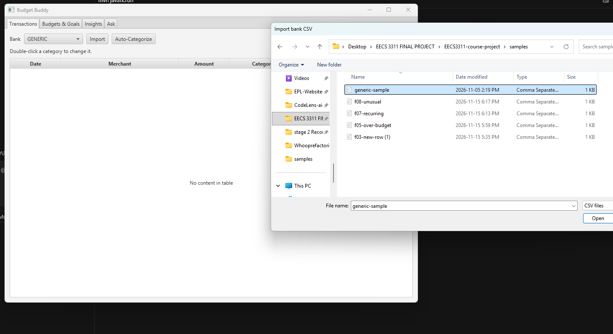

*Figure 1. The Import bank CSV dialog, with the GENERIC layout selected and `samples/generic-sample.csv` chosen.*

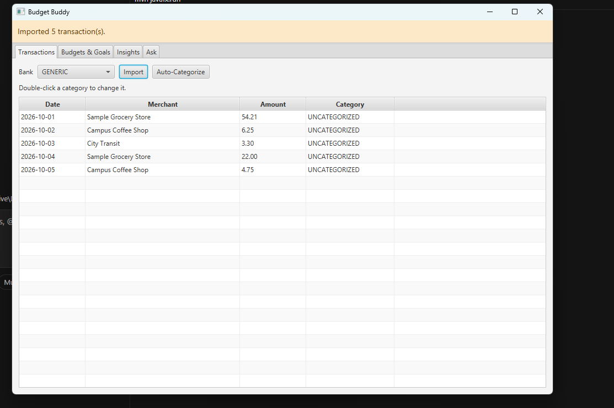

*Figure 2. The Transactions tab after the import. The banner reports five imported transactions, and each Category shows UNCATEGORIZED until categorization runs (F02).*

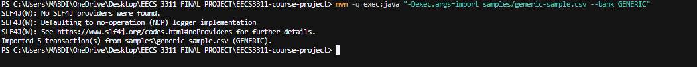

*Figure 3. The F01 import from the command line, reporting five transactions imported from `generic-sample.csv`.*

**Changes from Stage 1.** Stage 1 runs categorization automatically after import. The implementation saves imported rows as UNCATEGORIZED, and categorization runs as a separate step (`categorize` in the CLI, Auto-Categorize in the GUI). Impact: imported rows show UNCATEGORIZED until that step runs.

### F02 AI Auto-Categorization

**Original requirement (Stage 1):** Gives each transaction a category. Saved rules handle known merchants first, then the LLM categorizes the rest, and each transaction records its source (rule, AI, or user) and a confidence score. An Auto-Categorize button re-runs the step on uncategorized rows. Errors: without a key the app uses rules only; an invalid reply or unknown category leaves the transaction uncategorized; user-set categories are never overwritten.

**How it is implemented.** `CategorizationService` calls the active `CategorizationStrategy`. `RuleBasedStrategy` applies saved merchant rules first. `AiAssistedStrategy` sends the rest through `PromptBuilder` to `ClaudeAdapter`, parses the reply with `JsonReply`, and keeps any suggestion below confidence 0.6 as UNCATEGORIZED. Without a key, the service uses rules only. Patterns: Strategy and Adapter.

**Screenshots.**

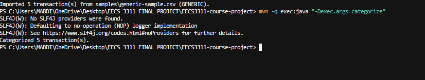

*Figure 4. The `categorize` command on the five imported transactions, reporting five categorized.*

**Changes from Stage 1.** Stage 1 asks for low-confidence results to be highlighted for review. The implementation keeps those transactions as UNCATEGORIZED and does not save a separate review flag.

### F03 Category Correction and Learning

**Original requirement (Stage 1):** Lets the user fix a category. If the user chooses to remember it, a rule is saved for that merchant, applied to matching transactions now, and used for future imports and as an example for the LLM. Errors: a missing transaction shows an error, and an existing merchant rule is confirmed before it is replaced.

**How it is implemented.** `BudgetBuddyFacade.correctCategory()` passes the change to `CategorizationService`, which marks the transaction as set by the user (source USER). When remember is set, `CategoryRuleRepository` saves the merchant rule, and other transactions from that merchant that the user has not set are updated. Budgets are then rechecked. The GUI opens the change dialog from a double-click on the Category cell. Patterns: Facade and Strategy.

**Screenshots.**

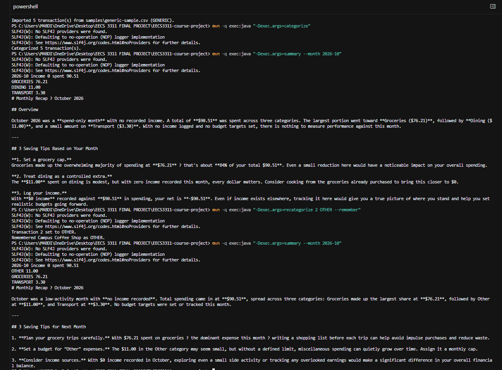

*Figure 5. The summary before the correction, then `recategorize 2 OTHER --remember` with its output, then the summary after. Campus Coffee Shop moves to OTHER, and its other unset transaction follows.*

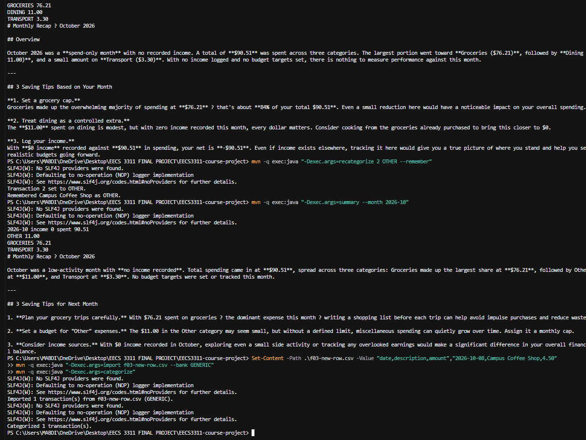

*Figure 6. A new Campus Coffee Shop row is imported and categorized after the rule was saved.*

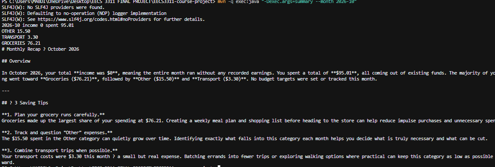

*Figure 7. The summary after the new row. OTHER totals 15.50, which is 11.00 plus the new 4.50, so the rule applied to the new transaction.*

**Changes from Stage 1.** No change in behaviour. The CLI reports the remembered merchant in its output, and the rule also updates other unset transactions from that merchant.

### F04 Budget Management

**Original requirement (Stage 1):** Create, edit, and delete monthly spending limits per category, and copy last month's budgets into a new month. Input: month, category, and amount. Errors: a non-positive amount is a validation error, and an existing budget for the same category and month is confirmed before it is replaced.

**How it is implemented.** `BudgetsGoalsController` calls `BudgetBuddyFacade.saveBudget()`. `BudgetService` validates the amount and month and stores the `Budget` through `BudgetRepository`. `copyBudgets()` copies a month's budgets to the next month, and the facade rechecks budgets afterwards. Patterns: Facade and MVC.

**Screenshots.**

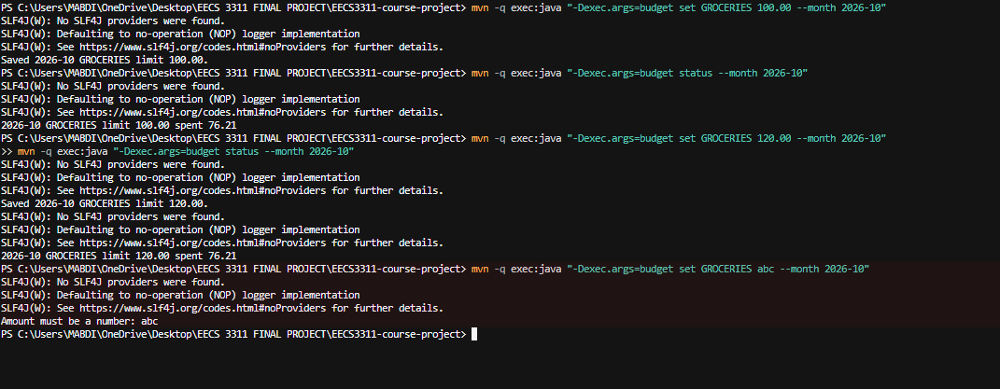

*Figure 8. `budget set GROCERIES 100.00`, then `budget status`, then `budget set GROCERIES 120.00` replacing the limit, then an invalid amount that prints "Amount must be a number: abc."*

**Changes from Stage 1.** The CLI replaces an existing limit without asking for confirmation, which differs from the Stage 1 requirement for the GUI. The shown run confirms that a second `budget set` replaces the earlier limit.

### F05 Budget Tracking and Alerts

**Original requirement (Stage 1):** Shows how much of each budget has been used and raises an alert at 80% (warning) and 100% (exceeded), sent to whichever interface is running, using fixed templates so no LLM is needed. Errors: a category with spending but no budget shows "No budget set," and a level already alerted in the month is not alerted again.

**How it is implemented.** After `BudgetService.recalculate()` totals the month's spending, any budget that reaches a new level notifies every registered `BudgetAlertListener`. `GuiBudgetAlertListener` and `BudgetBuddyCli` implement the interface, and the CLI prints the message. Patterns: Observer.

**Screenshots.**

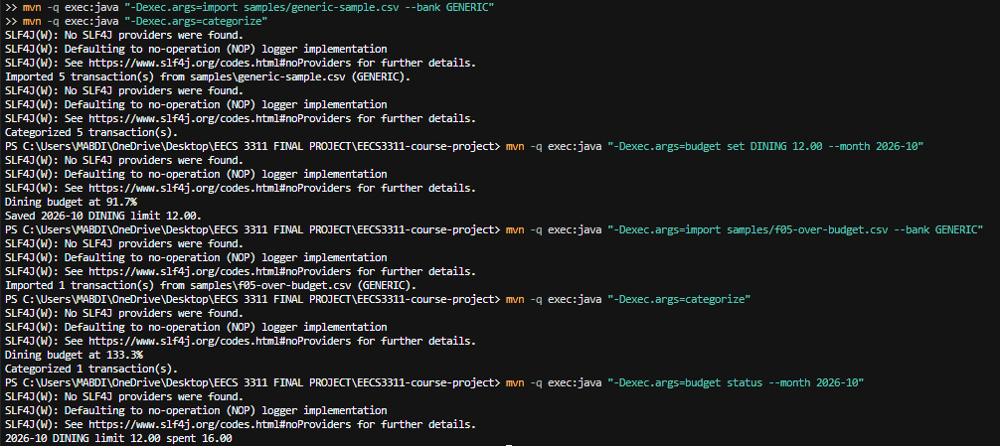

*Figure 9. The warning "Dining budget at 91.7%" when the limit is set, then "Dining budget at 133.3%" after the over-budget row is categorized.*

**Changes from Stage 1.** Stage 1 says alerts follow an import, a correction, or a budget change. The run shows the alert also follows the `categorize` command, so that command is one of the triggers.

### F06 Spending Trends and Charts

**Original requirement (Stage 1):** Shows spending over a range of months: a pie chart by category, a bar chart per month, and a table with month-over-month change. The CLI prints a text table. Errors: a start month after the end month is a validation error, and an empty range shows an empty state.

**How it is implemented.** `InsightsController` passes the request through `InsightsLogic` to the facade. `AnalyticsService.getTrends()` builds `MonthlySummary` values from stored transactions, and the view displays them. Patterns: Facade and MVC.

**Screenshots.**

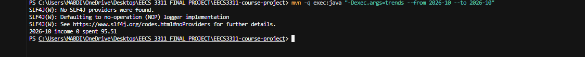

*Figure 10. `trends --from 2026-10 --to 2026-10`, showing October 2026 with zero income and total spending of 95.51.*

**Changes from Stage 1.** The CLI prints one line per month with income and spending. It does not print the month-over-month change column that Stage 1 describes for the table. The charts are in the GUI only.

### F07 Recurring Payment Detection

**Original requirement (Stage 1):** Finds charges that repeat on a regular schedule (weekly, monthly, or yearly). The LLM then labels each one as a subscription or a regular bill and gives it a readable name. Input: the last six months of transactions. Output: name, amount, frequency, next expected date, and subscription flag. Errors: under three months of data shows a warning, and an unavailable LLM shows the list without labels.

**How it is implemented.** `AnalyticsService.detectRecurring()` groups charges by merchant, keeps merchants with at least three charges at regular intervals and similar amounts, and returns `RecurringPayment` objects. `BudgetBuddyAgent.labelSubscriptions()` then asks the LLM to label them. Patterns: Facade and Adapter.

**Screenshots.**

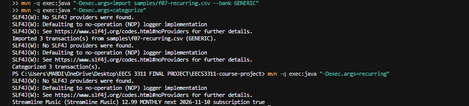

*Figure 11. `recurring` lists Streamline Music at 12.99, monthly, with the next expected date of 2026-11-10 and the subscription flag set to true.*

**Changes from Stage 1.** In this run the output shows the merchant name as the label, not a separate readable name. The report does not claim an LLM label for this run, and the AI labelling depends on the API key being set.

### F08 Unusual Expense Detection

**Original requirement (Stage 1):** Flags transactions much larger than usual for their category, and the LLM explains each one in plain language. Input: the selected month, with the previous three months as a baseline. Output: flagged transactions with explanations.

**How it is implemented.** `AnalyticsService.detectUnusual()` flags transactions above three times the category's average over the prior three months, and new merchants charging more than $200, as `Anomaly` objects. `BudgetBuddyAgent.explainAnomalies()` asks the LLM to explain them. Patterns: Facade and Adapter.

**Screenshots.**

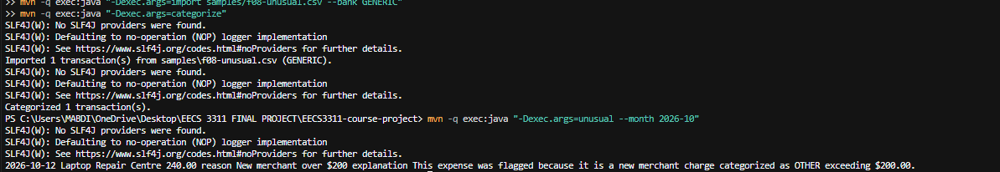

*Figure 12. `unusual --month 2026-10` flags Laptop Repair Centre at 240.00 with the reason "New merchant over $200."*

**Changes from Stage 1.** The explanation in this run is the reason text for the rule that flagged the item. The report does not claim a separate LLM explanation for this run.

### F09 Ask Budget Buddy

**Original requirement (Stage 1):** The main agent feature. The user asks a plain-English question, and the agent uses tools to get real figures before it answers. It remembers the conversation, so follow-up questions work. Output: the answer and the list of tools used. Errors: a tool failure is sent back to the LLM, the step limit returns a partial answer, and an unavailable API shows an offline message.

**How it is implemented.** `BudgetBuddyFacade.ask()` calls `BudgetBuddyAgent.ask()`. The agent sends the conversation and the tool list from `ToolRegistry` to `ClaudeAdapter`. When the LLM requests a tool, `ToolRegistry.execute()` runs it, and `SpendingTool`, `BudgetTool`, and `GoalsTool` read from the services. `ConversationMemory` keeps the turns, and the loop ends at a text reply or six steps. Patterns: Command, Adapter, and Facade.

**Screenshots.**

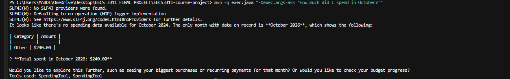

*Figure 13. The `ask` command answering a question about October spending, with the tools used listed below the answer. The answer also names the wrong year for part of the text (see Section 1).*

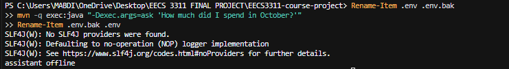

*Figure 14. With `.env` renamed so no key is loaded, the same command prints "assistant offline."*

**Changes from Stage 1.** The answer can name the wrong year. In the shown run it mentions October 2024 while reporting October 2026, which is a limitation of the current prompt. The offline path matches the Stage 1 requirement.

### F10 Monthly Summary

**Original requirement (Stage 1):** A short recap of a month. Java calculates income, spending, top categories, and budget results, then the LLM writes a short summary with three saving tips based only on those numbers. Output: the stats with the written recap. Errors: a month with no transactions shows an error, and an unavailable LLM shows the stats only.

**How it is implemented.** `AnalyticsService.generateMonthlySummary()` computes the figures with `buildMonthlyStats()`. `BudgetBuddyAgent.writeMonthlySummary()` asks the LLM for the recap, using `PromptBuilder`. `InsightsController` shows the result in the GUI, and the CLI prints it. Patterns: Facade and Adapter.

**Screenshots.**

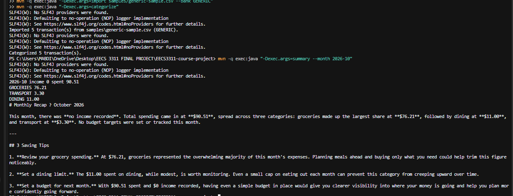

*Figure 15. `summary --month 2026-10`, with income 0, spending 90.51, the category totals, and the written recap with three tips.*

**Changes from Stage 1.** No change. The figures match the categorized transactions, and the recap uses only those figures.

### F11 Savings Goals and AI Saving Plan

**Original requirement (Stage 1):** The user creates savings goals (name, target, deadline) and logs contributions. When asked, the agent looks at recent spending through its tools and suggests a plan: how much to save per month and which spending to cut. Errors: a non-positive target or a past deadline is a validation error, a reached goal needs no plan, and an unavailable LLM shows only the required amount per month.

**How it is implemented.** `BudgetsGoalsController` (GUI) and `budgetbuddy goal` (CLI) call `BudgetBuddyFacade`, which uses `GoalService` to save goals and contributions through `GoalRepository`. `generateSavingPlan()` loads the goal and calls `BudgetBuddyAgent.proposeSavingPlan()`, which clears memory and runs the agent with `GoalsTool` and `SpendingTool`. If no usable plan comes back, the app shows the required monthly amount. Patterns: Command, Adapter, and Facade.

**Screenshots.**

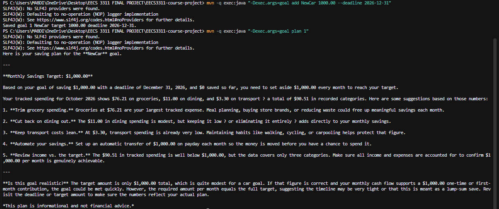

*Figure 16. The goal `NewCar` is saved as goal 1 with a target of 1000.00 and a deadline of 2026-12-31. The plan reports 1000.00 per month for the run from November 23, 2026 to December 31, 2026.*

**Changes from Stage 1.** The required monthly amount counts whole months from the current month to the deadline month, and the current month is not counted. This run was made on November 23, 2026 with a deadline of December 31, 2026, so only December counts and the full target is the monthly figure. A later deadline gives a lower figure, for example about $142.86 per month for June 30, 2027. Contributions are added in the GUI only, and the plan can be incomplete on some runs (Section 1).

# 3. Implemented Design Patterns

The application implements six patterns. The requirement is five.

**3.1 Facade.** *Problem:* the GUI and CLI should not depend on the services, repositories, and agent directly. `BudgetBuddyFacade` (package `ca.budgetbuddy`) is the single entry point. Its methods, including `importTransactions()`, `saveBudget()`, `correctCategory()`, `ask()`, `generateMonthlySummary()`, and `generateSavingPlan()`, each coordinate several collaborators. *Stage 1:* matches.

**3.2 Strategy.** *Problem:* categorization can use rules alone or rules plus the LLM. `CategorizationStrategy` is the interface. `RuleBasedStrategy` and `AiAssistedStrategy` are the implementations. `CategorizationService.setStrategy()` switches between them and falls back to `RuleBasedStrategy` when the key is missing or the call fails. *Stage 1:* matches.

**3.3 Observer.** *Problem:* budget alerts must reach the GUI and CLI without `BudgetService` knowing about either. `BudgetAlertListener` is the observer interface. `BudgetService.addAlertListener()` registers listeners, `notifyListeners()` sends alerts, and `GuiBudgetAlertListener` and `BudgetBuddyCli` implement the interface. *Stage 1:* matches.

**3.4 Command.** *Problem:* the agent must run different tools chosen by the LLM through one uniform call. `AgentTool` is the command interface. `SpendingTool`, `BudgetTool`, and `GoalsTool` implement it. `ToolRegistry` looks tools up by name and executes them. The agent loop in `BudgetBuddyAgent` acts as the invoker. *Stage 1:* matches, including the `AgentTool` and `ToolRegistry` names.

**3.5 Adapter.** *Problem:* the application should not depend on the Anthropic SDK directly, so the LLM can be swapped and tested offline. `LLMClient` is the target interface. `ClaudeAdapter` adapts the Anthropic API to it, and `MockLlmClient` is a test double. *Stage 1:* matches.

**3.6 Model-View-Controller.** *Problem:* JavaFX views should not contain business logic. Views are the FXML files under `src/main/resources/ca/budgetbuddy/gui/`. Controllers (`MainController`, `TransactionsController`, `BudgetsGoalsController`, `InsightsController`, `AskController`) handle events. Logic classes (`TransactionsLogic`, `BudgetsGoalsLogic`, `InsightsLogic`, `AskLogic`) hold the testable presentation logic. Models are in `ca.budgetbuddy.model`. *Stage 1:* matches, with the controller names listed in Section 4.

**3.7 Updated UML class diagram.** The implemented system is shown in three parts, matching the three-part Stage 1 class diagram. Part 1 covers the presentation layer and the facade, part 2 covers services, the agent, and the LLM layer, and part 3 covers the domain model and persistence. The Mermaid source for each part is in `docs/diagrams/`.

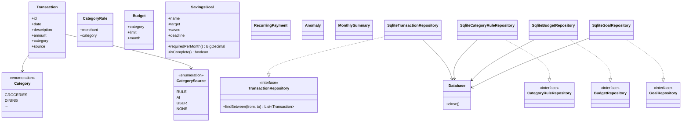

**3.8 Updated sequence diagrams.** The F09 and F11 sequence diagrams differ from Stage 1 (SD05 and SD06), so they are updated below. The F10 part of SD06 is kept, with the presentation participant changed to `InsightsController`. The use-case diagram (UC01 to UC11) does not change, since no use cases were added or removed.

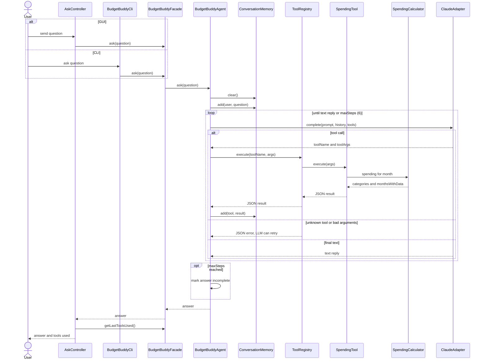

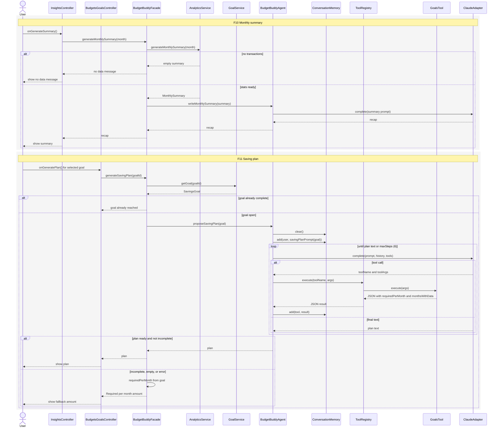

**What changed from Stage 1 (diagrams).**

- **Class diagram:** The root package is now `ca.budgetbuddy.*`. `ChatController` became `AskController`, and `DashboardController` was removed. Its monthly summary moved to `InsightsController`, and `MainController` is the shell. `GuiBudgetAlertListener` replaces the dashboard alert listener. `GoalService`, `SpendingCalculator`, `JsonReply`, `LlmConfig`, `LlmConfigLoader`, and `MockLlmClient` were added. The GUI logic classes separate presentation logic from the controllers.
- **F09 sequence (SD05):** `AskController` replaces `ChatController`. The agent clears `ConversationMemory` at the start of each request. `ToolRegistry` returns JSON errors for unknown tools and bad arguments. Empty spending results include `monthsWithData`. The loop ends at a text reply or after six steps, and `getLastToolsUsed()` is shown afterward.
- **F11 sequence (SD06):** The saving plan starts at `BudgetsGoalsController` and goes through `generateSavingPlan`, which loads the goal and calls `proposeSavingPlan`. That method clears memory and builds the prompt with `savingPlanPrompt`. If the answer is incomplete, empty, or fails, the facade shows the required monthly amount instead of the raw "Incomplete answer" text.

# 4. Changes and Rationale

Format: original design, implemented change, reason, impact.

1. **Features F01 to F11.** Original: Stage 1 design. Implemented: all 11 features, with the same IDs. Reason: no change needed. Impact: none.
2. **Presentation controllers.** Original: `ChatController`, `DashboardController`. Implemented: `AskController`, `MainController`, and `InsightsController`. Reason: the GUI uses four tabs (Transactions, Budgets and Goals, Insights, Ask) instead of the single screens described in Stage 1. Impact: the MVC diagram and UC09 use the new names.
3. **Service layer.** Original: `AnalyticsService`, `BudgetService`, `CategorizationService`, `ImportService`. Implemented: those plus `GoalService` and `SpendingCalculator`. Reason: goal rules and spending arithmetic were separated from the facade and analytics code so they can be tested. Impact: F05 and F11 route through these classes.
4. **Agent memory.** Original: Stage 1 describes an agent loop without memory. Implemented: `ConversationMemory` keeps earlier turns for F09, and it is cleared at the start of each new ask or plan request. Reason: follow-up questions need prior context, and stale context made the model query empty months. Impact: `BudgetBuddyAgent` takes a memory object and a step limit (6).
5. **Model configuration.** Original: Stage 1 names Claude as the LLM. Implemented: the model name is read from configuration (`ANTHROPIC_MODEL` in `.env`) instead of being hard-coded. Reason: the model can change without code edits. Impact: `LlmConfig` and `LlmConfigLoader`.
6. **F09 and F11 tool results.** Original: `SpendingTool` returned empty category maps with no hint about which months had data. Implemented: empty results include `monthsWithData`, and the saving-plan prompt is steered toward those months. Reason: the model guessed months with no transactions and used up the step limit. Impact: F09 and F11 get usable tool output, and F11 falls back to a Required per month plan.
7. **JSON replies from Claude.** Original: the categorization parser expected raw JSON. Implemented: `JsonReply` strips markdown code fences before parsing. Reason: Claude often wraps JSON in fences, which made parsing fail silently. Impact: F02 and the other JSON-based LLM replies parse reliably.

# 5. AI Tools and Collaboration Log

| Tool / platform | LLM / model | Used for | Token cost | Money cost |
|---|---|---|---|---|
| Cursor (Agent mode) | Cursor Agent (Auto / Composer) | Writing most of the Java code: GUI, CLI, services, and tests | Included in the Cursor plan | $0 (Cursor Pro, free under the student plan) |
| Claude via Anthropic API (runtime) | `claude-sonnet-4-6` (set in local `.env`; the `.env.example` default is `claude-sonnet-4-20250514`) | Runtime LLM for F02, F07, F08, F09, F10, and F11 | 13,429 input and 4,984 output tokens (18,413 total), last 30 days, from the Usage page | $0.03, from the Cost page for the last 30 days (data as of Nov 15, 2026) |

**Representative interactions.** Each item shows what was asked and what was kept.

1. **LLM layer.** Asked Cursor to add package `ca.budgetbuddy.llm` with `LLMClient`, `LlmResponse`, `MockLlmClient`, and `ClaudeAdapter`, loading the key from the environment, `.env`, or `config.local.json`, with tests that never call the real API. Kept after review.
2. **Agent loop.** Asked for `ToolRegistry`, `ConversationMemory`, and `BudgetBuddyAgent.ask()` that loops on tool calls until a text reply or `maxSteps`, returning a JSON error for unknown tools. Kept. Memory `clear()` was added later for F11.
3. **JavaFX GUI.** Asked for an MVC GUI with FXML that calls only `BudgetBuddyFacade`, with four tabs. Kept. The controller names differ from Stage 1 (Section 4, item 2).
4. **F02 defect.** Auto-categorize reported Categorized 0 with a working key because Claude wrapped its JSON in markdown fences. Asked for fence stripping before parsing, which produced `JsonReply`. Fixed in commit `fdaf5c5`.
5. **F11 defect.** Get AI Plan returned the internal "Incomplete answer" text after the model queried empty months. Asked for the `monthsWithData` change, prompt steering, memory clear, and a fallback plan. Fixed in commit `66c3e98`. The plan can still come back incomplete on some runs (Section 1).

The code was reviewed and run by the author before submission. AI-generated changes were kept only after the author read them and tested them in the GUI or CLI.

# 6. Development and Verification Summary

**Weekly commit summary.**

Period 1 (Oct 20 to 26): none

Period 2 (Oct 27 to Nov 2):

- [`ba67da9`](https://github.com/Abdi238/eecs3311-course-project/commit/ba67da9): Add TD and RBC bank layouts to CSV import (Oct 30)
- [`5efb319`](https://github.com/Abdi238/eecs3311-course-project/commit/5efb319): Add generic CSV import service with validation (Oct 30)
- [`8e4f167`](https://github.com/Abdi238/eecs3311-course-project/commit/8e4f167): Add domain model and SQLite repositories (Oct 30)
- [`2d97a7b`](https://github.com/Abdi238/eecs3311-course-project/commit/2d97a7b): Add duplicate detection and rule-based categorization (Oct 31)
- [`dbd4ef7`](https://github.com/Abdi238/eecs3311-course-project/commit/dbd4ef7): Add category correction and remember-this-merchant learning (Oct 31)

Period 3 (Nov 3 to 9):

- [`7ebd240`](https://github.com/Abdi238/eecs3311-course-project/commit/7ebd240): Add LLM client interface, mock client, and Claude adapter
- [`e5c33d7`](https://github.com/Abdi238/eecs3311-course-project/commit/e5c33d7): Add agent loop with tool registry and conversation memory
- [`d1b2683`](https://github.com/Abdi238/eecs3311-course-project/commit/d1b2683): Add facade and CLI with real finance tools
- [`5ab799c`](https://github.com/Abdi238/eecs3311-course-project/commit/5ab799c): Add JavaFX GUI with transactions, budgets, goals, and ask tabs
- [`8ce0ad4`](https://github.com/Abdi238/eecs3311-course-project/commit/8ce0ad4): Add budget alerts observer and AI categorization strategy
- [`5a0b77a`](https://github.com/Abdi238/eecs3311-course-project/commit/5a0b77a): Add recurring payments, unusual expenses, and monthly summary
- [`61d31d9`](https://github.com/Abdi238/eecs3311-course-project/commit/61d31d9): Add AI saving plan and README run instructions

Commits `fdaf5c5` and `66c3e98` (Section 5, items 4 and 5) were made after the period 3 window and are not counted toward any minimum.

**Checks performed.**

- Static review that each Stage 1 feature has a reachable method from both the GUI and the CLI (Section 2).
- Unit tests cover the domain model, CSV import, categorization, budget service, agent, facade, GUI logic, and the Claude adapter (`src/test/java`). Tests use `MockLlmClient`, so they never call the real API.
- `mvn test` run locally: `Tests run: 91, Failures: 0, Errors: 0, Skipped: 0`, with `BUILD SUCCESS`.
- Secrets check: `.env` and `config.local.json` are listed in `.gitignore`, and `.env.example` contains only placeholders. A search of the full repository history (`git log --all -S "sk-ant-"`) found no Anthropic key, and no commit ever added `.env` or `config.local.json`. Any key shown during demos was revoked and replaced locally in `.env`.

**Defects found and corrected.**

1. F02 auto-categorization reported Categorized 0 because Claude wrapped JSON in markdown fences and the parser failed silently. Fixed with `JsonReply` (`fdaf5c5`).
2. F11 Get AI Plan showed the internal step-limit text after empty-month queries. Fixed with `monthsWithData`, prompt steering, memory clear, and the Required per month fallback (`66c3e98`).
3. A revoked Anthropic key caused Ask and categorization to fail with no clear GUI error. Resolved by putting a valid key in local `.env` and confirming it from the CLI before using the GUI.

**Remaining limitations.** See Section 1. Full deterministic testing and KUMA agent validation are Stage 3 work.

# 7. Demonstration Index

Each feature has its own video. Both the GUI and the CLI are shown across the set. All links are shared publicly on Google Drive, and no API keys or credentials appear in the recordings.

| Feature | Interface shown | Video |
|---|---|---|
| F01 Import transactions | GUI and CLI | [F01 video](https://drive.google.com/file/d/1edJRtekiVCy1tNSHZtkapC8zIw6ISOwF/view?usp=drive_link) |
| F02 AI auto-categorization | GUI and CLI | [F02 GUI video](https://drive.google.com/file/d/1mmB7g29cfgacoRwTIsPxu5ploezEjeQd/view?usp=drive_link), [F02 CLI video](https://drive.google.com/file/d/1IuBSHHc4pOLSCaFGiYHFq1yBoOFRcMsQ/view?usp=sharing) |
| F03 Category correction and learning | GUI and CLI | [F03 GUI video](https://drive.google.com/file/d/1VnK_T5DSReParZvzGUhb4vScgT2HXuUe/view?usp=drive_link), [F03 CLI video](https://drive.google.com/file/d/11m6AwW-Cr7p3oinZLpvCZepA4Qf4BWo3/view?usp=sharing) |
| F04 Budget management | GUI and CLI | [F04 video](https://drive.google.com/file/d/12HoTtHiatxse6n-DuCJNfGgts0wKkDm8/view?usp=drive_link) |
| F05 Budget tracking and alerts | GUI and CLI | [F05 video](https://drive.google.com/file/d/14fdMME_70fTajs-fI3orGKiu19BqT6aZ/view?usp=drive_link) |
| F06 Spending trends | GUI and CLI | [F06 video](https://drive.google.com/file/d/1PRUUtAXOKR_kUGtTG6PhCdF67fk8r4co/view?usp=drive_link) |
| F07 Recurring payments | GUI and CLI | [F07 video](https://drive.google.com/file/d/14EzGuTKlZy-7jtr5Va4UtqXCCS-VBy4W/view?usp=drive_link) |
| F08 Unusual expenses | GUI and CLI | [F08 video](https://drive.google.com/file/d/1xDQFumH5AUeYzkWPH0XtSIQeP9P4m8tE/view?usp=drive_link) |
| F09 Ask Budget Buddy | GUI and CLI | [F09 GUI video](https://drive.google.com/file/d/1S2oPRilMdNJgTRyi2V3XgLCrZlkkaDbx/view?usp=drive_link), [F09 CLI video](https://drive.google.com/file/d/1Ic_IrIvCt5cNES34f6YePHqmyhueNHS3/view?usp=sharing) |
| F10 Monthly summary | GUI and CLI | [F10 GUI video](https://drive.google.com/file/d/1YPsWSvFhtETNshCNymXdtcsIgH9Q7HIQ/view?usp=drive_link), [F10 CLI video](https://drive.google.com/file/d/1YQY6upCBiWEEH61B1Ts9c4EeDktoP0Y6/view?usp=sharing) |
| F11 Savings goals and AI plan | GUI and CLI | [F11 GUI video](https://drive.google.com/file/d/16TmqAJia6-IpeV8NJQrQ5VcxDdfwrX0L/view?usp=drive_link), [F11 CLI video](https://drive.google.com/file/d/1RYU2Dv9qSUOAhwZy2ZBzFt2KwSXDMDnX/view?usp=sharing) |
