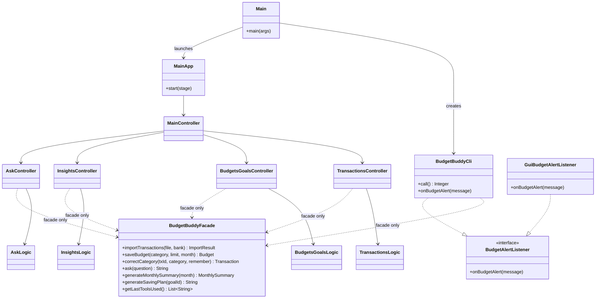
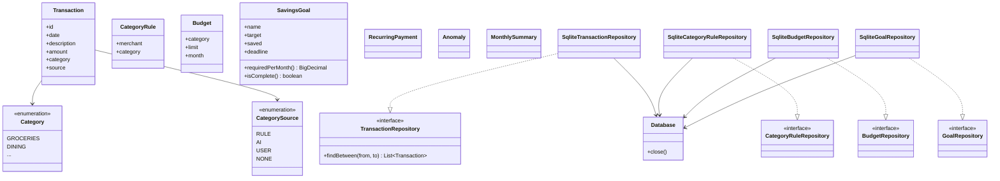
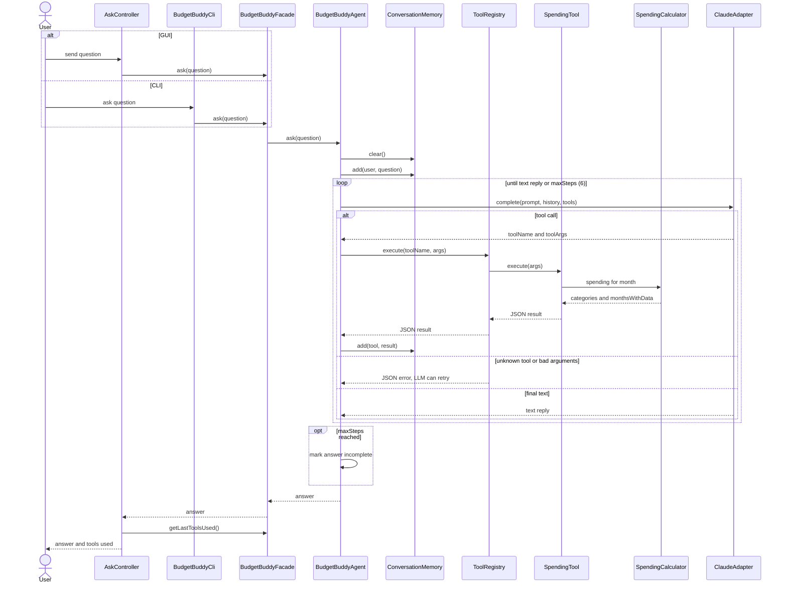
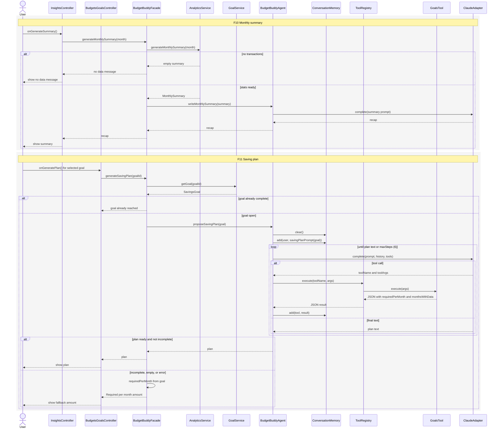

# 1. Project Overview and Implementation Status

Budget Buddy is a personal finance assistant for a single user. The user imports bank CSV exports (TD, RBC, or a generic layout). The application categorizes transactions, tracks monthly budgets and savings goals, reports spending trends, and answers questions in plain language. It runs as a JavaFX desktop GUI and as a picocli command-line interface. Both interfaces call the same `BudgetBuddyFacade`. Data is stored locally in SQLite.

The AI component is Claude, accessed through the Anthropic API via `ClaudeAdapter`. The LLM is used in three ways:

- **Categorization (F02):** the LLM labels transactions that the merchant rules do not cover. Its JSON reply is validated before use.
- **Agent behavior (F09, F11):** a tool-using agent loop (`BudgetBuddyAgent`) lets the LLM call spending, budget, and goal tools over several steps, with conversation memory, to answer questions and write a saving plan.
- **Explanation and labeling (F07, F08, F10):** the LLM names recurring subscriptions, explains unusual expenses, and writes the monthly recap. Java computes the underlying facts first.

If no API key is configured, the application runs with rules-only categorization and an offline assistant. Mock and offline paths are covered by unit tests.

**Implementation status:** all eleven Stage 1 features (F01 to F11) are implemented and reachable from both the GUI and the CLI.

**Limitations and incomplete work:**

- The full deterministic test suite and KUMA agent validation are Stage 3 work. Stage 2 includes only basic verification (Section 6).
- AI-assisted features need a live API key, and their output can differ between runs.
- CSV import supports only the TD, RBC, and generic layouts.
- The AI saving plan (F11) can return an incomplete answer. The agent sometimes exhausts its 6-step limit while querying spending, and the app then shows a step-limit message instead of a plan. The plan prompt does not include today's date, so the model can choose a month with no data.
- Savings goals and transactions cannot be edited or deleted in the GUI. Budgets and goals cannot be edited in place. Test data was cleared by resetting the local database.
- The GUI has minimal empty-state guidance. Ask (F09) shows no offline banner when the API key is missing or invalid, so a failed key can look like an empty reply until checked in the CLI.

# 2. Feature to Implementation Mapping

Stage 1 details are in `docs/Stage1_Report.md`. All features keep their Stage 1 IDs and names.

| Feature | Stage 1 ref. | Status | Classes and files | Key methods | Patterns | Video |
|---|---|---|---|---|---|---|
| F01 Import transactions | F01 | Implemented | `ImportService`, `TransactionsController`, `BudgetBuddyCli`, `BudgetBuddyFacade` | `importFile()`, `parseRow()`, `importTransactions()` | Facade, MVC | [F01](https://drive.google.com/file/d/1edJRtekiVCy1tNSHZtkapC8zIw6ISOwF/view?usp=drive_link) |
| F02 AI auto-categorization | F02 | Implemented (hybrid) | `CategorizationService`, `CategorizationStrategy`, `RuleBasedStrategy`, `AiAssistedStrategy`, `PromptBuilder`, `ClaudeAdapter` | `categorize()`, `categorizeUncategorized()`, `categorizePrompt()`, `complete()` | Strategy, Adapter | [F02](https://drive.google.com/file/d/1mmB7g29cfgacoRwTIsPxu5ploezEjeQd/view?usp=drive_link) |
| F03 Category correction and learning | F03 | Implemented (hybrid) | `CategorizationService`, `CategoryRuleRepository`, `BudgetBuddyFacade`, `TransactionsController` | `correctCategory()`, `setCategory()`, `save()` | Facade, Strategy | [F03](https://drive.google.com/file/d/1VnK_T5DSReParZvzGUhb4vScgT2HXuUe/view?usp=drive_link) |
| F04 Budget management | F04 | Implemented | `BudgetService`, `BudgetRepository`, `Budget`, `BudgetsGoalsController`, `BudgetBuddyFacade` | `saveBudget()`, `deleteBudget()`, `copyBudgets()` | Facade, MVC | [F04](https://drive.google.com/file/d/12HoTtHiatxse6n-DuCJNfGgts0wKkDm8/view?usp=drive_link) |
| F05 Budget tracking and alerts | F05 | Implemented | `BudgetService`, `BudgetAlertListener`, `GuiBudgetAlertListener`, `BudgetBuddyCli` | `recalculate()`, `notifyListeners()`, `onBudgetAlert()` | Observer | [F05](https://drive.google.com/file/d/14fdMME_70fTajs-fI3orGKiu19BqT6aZ/view?usp=drive_link) |
| F06 Spending trends | F06 | Implemented | `AnalyticsService`, `InsightsController`, `InsightsLogic`, `MonthlySummary` | `getTrends()`, `getSpendingTrends()` | Facade, MVC | [F06](https://drive.google.com/file/d/1PRUUtAXOKR_kUGtTG6PhCdF67fk8r4co/view?usp=drive_link) |
| F07 Recurring payments | F07 | Implemented (hybrid) | `AnalyticsService`, `RecurringPayment`, `BudgetBuddyAgent` | `detectRecurring()`, `labelSubscriptions()` | Facade, Adapter | [F07](https://drive.google.com/file/d/14EzGuTKlZy-7jtr5Va4UtqXCCS-VBy4W/view?usp=drive_link) |
| F08 Unusual expenses | F08 | Implemented (hybrid) | `AnalyticsService`, `Anomaly`, `BudgetBuddyAgent` | `detectUnusual()`, `explainAnomalies()` | Facade, Adapter | [F08](https://drive.google.com/file/d/1xDQFumH5AUeYzkWPH0XtSIQeP9P4m8tE/view?usp=drive_link) |
| F09 Ask Budget Buddy | F09 | Implemented (AI agent) | `BudgetBuddyAgent`, `ToolRegistry`, `AgentTool`, `SpendingTool`, `BudgetTool`, `GoalsTool`, `ConversationMemory`, `AskController`, `AskLogic` | `ask()`, `execute()`, `complete()`, `getLastToolsUsed()` | Command, Adapter, Facade | [F09](https://drive.google.com/file/d/1S2oPRilMdNJgTRyi2V3XgLCrZlkkaDbx/view?usp=drive_link) |
| F10 Monthly summary | F10 | Implemented (hybrid) | `AnalyticsService`, `MonthlySummary`, `BudgetBuddyAgent`, `PromptBuilder`, `InsightsController` | `generateMonthlySummary()`, `buildMonthlyStats()`, `writeMonthlySummary()` | Facade, Adapter | [F10](https://drive.google.com/file/d/1YPsWSvFhtETNshCNymXdtcsIgH9Q7HIQ/view?usp=drive_link) |
| F11 Savings goals and AI plan | F11 | Implemented (hybrid) | `GoalService`, `GoalRepository`, `SavingsGoal`, `BudgetBuddyAgent`, `GoalsTool`, `BudgetsGoalsController` | `createGoal()`, `addContribution()`, `generateSavingPlan()`, `proposeSavingPlan()` | Command, Adapter, Facade | [F11](https://drive.google.com/file/d/16TmqAJia6-IpeV8NJQrQ5VcxDdfwrX0L/view?usp=drive_link) |

**How the classes collaborate.** Each entry starts at the user input and ends at the result.

- **F01, import (deterministic, with an AI step through F02).** `TransactionsController` or `budgetbuddy import` calls `BudgetBuddyFacade.importTransactions()`. `ImportService` converts each row with `parseRow()` using the chosen bank layout and skips duplicates. New rows go to `CategorizationService`, and `TransactionRepository` saves them. The facade then asks `BudgetService` to recheck budgets.
- **F02, categorization (hybrid).** `CategorizationService` calls the active `CategorizationStrategy`. `RuleBasedStrategy` applies saved merchant rules first. `AiAssistedStrategy` sends remaining rows through `PromptBuilder` to `ClaudeAdapter`, parses the reply, and keeps any suggestion below confidence 0.6 as UNCATEGORIZED. Without a key, the service uses rules only.
- **F03, correction and learning (hybrid).** Double-clicking the Category cell in `TransactionsController` opens the change dialog. `BudgetBuddyFacade.correctCategory()` passes the change to `CategorizationService`, which marks the transaction as set by the user. If "remember this merchant" is checked, `CategoryRuleRepository` saves a rule, and other transactions from that merchant that the user has not set are updated.
- **F04, budgets (deterministic).** `BudgetsGoalsController` calls `BudgetBuddyFacade.saveBudget()`. `BudgetService` validates the amount and month and stores the `Budget` through `BudgetRepository`. `copyBudgets()` copies a month's budgets to the next month.
- **F05, alerts (deterministic).** After `BudgetService.recalculate()` totals spending, any budget at 80% or 100% notifies each registered `BudgetAlertListener`. The GUI listener and the CLI both receive the alert.
- **F06, trends (deterministic).** `InsightsController` passes the request through `InsightsLogic` to the facade. `AnalyticsService.getTrends()` builds `MonthlySummary` values from stored transactions, and the view displays them.
- **F07, recurring payments (hybrid).** `AnalyticsService.detectRecurring()` finds charges from the same merchant with similar amounts and weekly, monthly, or yearly gaps, and returns `RecurringPayment` objects. `BudgetBuddyAgent.labelSubscriptions()` then asks the LLM to name them.
- **F08, unusual expenses (hybrid).** `AnalyticsService.detectUnusual()` flags transactions above three times the category's prior three-month average, and new merchants over $200, as `Anomaly` objects. `BudgetBuddyAgent.explainAnomalies()` asks the LLM to explain them.
- **F09, ask (AI agent).** `AskController` or `budgetbuddy ask` calls `BudgetBuddyFacade.ask()`, which calls `BudgetBuddyAgent.ask()`. The agent sends the conversation and the tool list from `ToolRegistry` to `ClaudeAdapter`. When the LLM requests a tool, `execute()` runs it. `SpendingTool`, `BudgetTool`, and `GoalsTool` read from the services. `ConversationMemory` keeps the turns, and the loop ends at a text reply or at the step limit.
- **F10, monthly summary (hybrid).** `AnalyticsService.generateMonthlySummary()` computes the figures with `buildMonthlyStats()`. `BudgetBuddyAgent.writeMonthlySummary()` asks the LLM for the written recap, using `PromptBuilder`. `InsightsController` shows the result.
- **F11, savings goals and AI plan (hybrid).** `BudgetsGoalsController` calls the facade, which calls `GoalService` to create goals and add contributions through `GoalRepository`. `generateSavingPlan()` runs the agent with `GoalsTool` and `SpendingTool`. If the agent does not return a usable plan, the app shows a fallback plan with the required monthly amount.

# 3. Implemented Design Patterns

The application implements six patterns. The requirement is five.

**3.1 Facade.** *Problem:* the GUI and CLI should not depend on the services, repositories, and agent directly. `BudgetBuddyFacade` (package `ca.budgetbuddy`) is the single entry point. Its methods, including `importTransactions()`, `saveBudget()`, `correctCategory()`, `ask()`, `generateMonthlySummary()`, and `generateSavingPlan()`, each coordinate several collaborators. *Stage 1:* matches.

**3.2 Strategy.** *Problem:* categorization can use rules alone or rules plus the LLM. `CategorizationStrategy` is the interface. `RuleBasedStrategy` and `AiAssistedStrategy` are the implementations. `CategorizationService.setStrategy()` switches between them and falls back to `RuleBasedStrategy` when the key is missing or the call fails. *Stage 1:* matches.

**3.3 Observer.** *Problem:* budget alerts must reach the GUI and CLI without `BudgetService` knowing about either. `BudgetAlertListener` is the observer interface. `BudgetService.addAlertListener()` registers listeners, `notifyListeners()` sends alerts, and `GuiBudgetAlertListener` and `BudgetBuddyCli` implement the interface. *Stage 1:* matches.

**3.4 Command.** *Problem:* the agent must run different tools chosen by the LLM through one uniform call. `AgentTool` is the command interface. `SpendingTool`, `BudgetTool`, and `GoalsTool` implement it. `ToolRegistry` looks tools up by name and executes them. The agent loop in `BudgetBuddyAgent` acts as the invoker. *Stage 1:* matches, including the `AgentTool` and `ToolRegistry` names.

**3.5 Adapter.** *Problem:* the application should not depend on the Anthropic SDK directly, so the LLM can be swapped and tested offline. `LLMClient` is the target interface. `ClaudeAdapter` adapts the Anthropic API to it, and `MockLlmClient` is a test double. *Stage 1:* matches.

**3.6 Model-View-Controller.** *Problem:* JavaFX views should not contain business logic. Views are the FXML files under `src/main/resources/ca/budgetbuddy/gui/`. Controllers (`MainController`, `TransactionsController`, `BudgetsGoalsController`, `InsightsController`, `AskController`) handle events. Logic classes (`TransactionsLogic`, `BudgetsGoalsLogic`, `InsightsLogic`, `AskLogic`) hold the testable presentation logic. Models are in `ca.budgetbuddy.model`. *Stage 1:* matches, with the controller names listed in Section 4.

**3.7 Updated UML class diagram.** The implemented system is shown in three parts, matching the three-part Stage 1 class diagram. Part 1 covers the presentation layer and the facade, part 2 covers services, the agent, and the LLM layer, and part 3 covers the domain model and persistence. The Mermaid source for each part is in `docs/diagrams/`.

```mermaid
classDiagram
    direction TB
    class BudgetBuddyFacade
    class ImportService {
        +importFile(path, bank) ImportResult
        +parseRow(row, bank)
    }
    class CategorizationService {
        -strategy
        +setStrategy(strategy)
        +categorize(transactions)
        +correctCategory(txId, category, remember)
    }
    class CategorizationStrategy {
        <<interface>>
        +categorize(transactions)
    }
    class RuleBasedStrategy {
        +categorize(transactions)
    }
    class AiAssistedStrategy {
        +MIN_CONFIDENCE 0.6
        +categorize(transactions)
    }
    class JsonReply {
        +stripFences(text) String
    }
    class PromptBuilder {
        +categorizePrompt(transactions, rules)$ String
        +savingPlanPrompt(goal)$ String
    }
    class BudgetService {
        +saveBudget(category, limit, month) Budget
        +recalculate(month)
        +addAlertListener(listener)
        -notifyListeners(message)
    }
    class BudgetAlertListener {
        <<interface>>
        +onBudgetAlert(message)
    }
    class AnalyticsService {
        +getSpendingTrends(from, to) List~MonthlySummary~
        +detectRecurring() List~RecurringPayment~
        +detectUnusual(month) List~Anomaly~
        +generateMonthlySummary(month) MonthlySummary
    }
    class GoalService {
        +createGoal(name, target, deadline) SavingsGoal
        +addContribution(goalId, amount) SavingsGoal
        +getGoal(goalId) SavingsGoal
    }
    class SpendingCalculator {
        +monthsWithData() List~YearMonth~
    }
    class BudgetBuddyAgent {
        -maxSteps = 6
        -lastAnswerIncomplete
        +ask(question) String
        +proposeSavingPlan(goal) String
        +labelSubscriptions(items)
        +explainAnomalies(items)
        +writeMonthlySummary(summary) String
        +getLastToolsUsed() List~String~
    }
    class ConversationMemory {
        +add(role, content)
        +clear()
    }
    class ToolRegistry {
        +execute(toolName, args) String
    }
    class AgentTool {
        <<interface>>
        +execute(args) String
    }
    class SpendingTool {
        +execute(args) String
    }
    class BudgetTool {
        +execute(args) String
    }
    class GoalsTool {
        +execute(args) String
    }
    class LLMClient {
        <<interface>>
        +complete(prompt, history, tools) LlmResponse
    }
    class ClaudeAdapter {
        +complete(prompt, history, tools) LlmResponse
    }
    class MockLlmClient {
        +complete(prompt, history, tools) LlmResponse
    }
    class LlmResponse {
        +text
        +toolName
        +toolArgs
    }
    class LlmConfigLoader {
        +load() LlmConfig
    }
    class LlmConfig

    BudgetBuddyFacade --> ImportService
    BudgetBuddyFacade --> CategorizationService
    BudgetBuddyFacade --> BudgetService
    BudgetBuddyFacade --> AnalyticsService
    BudgetBuddyFacade --> GoalService
    BudgetBuddyFacade --> SpendingCalculator
    BudgetBuddyFacade --> BudgetBuddyAgent

    CategorizationService o--> CategorizationStrategy : strategy
    RuleBasedStrategy ..|> CategorizationStrategy
    AiAssistedStrategy ..|> CategorizationStrategy
    AiAssistedStrategy --> LLMClient : uses
    AiAssistedStrategy ..> JsonReply : parses fenced JSON
    AiAssistedStrategy ..> PromptBuilder

    BudgetService o--> "0..*" BudgetAlertListener : notifies
    BudgetBuddyAgent --> LLMClient : complete()
    BudgetBuddyAgent --> ToolRegistry
    BudgetBuddyAgent --> ConversationMemory
    BudgetBuddyAgent ..> PromptBuilder

    ToolRegistry o--> "0..*" AgentTool : registers
    SpendingTool ..|> AgentTool
    BudgetTool ..|> AgentTool
    GoalsTool ..|> AgentTool
    SpendingTool --> SpendingCalculator
    BudgetTool --> SpendingCalculator
    GoalsTool --> GoalService

    ClaudeAdapter ..|> LLMClient
    MockLlmClient ..|> LLMClient
    ClaudeAdapter ..> LlmResponse
    ClaudeAdapter ..> LlmConfig
    LlmConfigLoader ..> LlmConfig
```

**3.8 Updated sequence diagrams.** The F09 and F11 sequence diagrams differ from Stage 1 (SD05 and SD06), so they are updated below. The F10 part of SD06 is kept, with the presentation participant changed to `InsightsController`. The use-case diagram (UC01 to UC11) does not change, since no use cases were added or removed.

**What changed from Stage 1 (diagrams).**

- **Class diagram:** The root package is now `ca.budgetbuddy.*`. `ChatController` became `AskController`, and `DashboardController` was removed. Its monthly summary moved to `InsightsController`, and `MainController` is the shell. `GuiBudgetAlertListener` replaces the dashboard alert listener. `GoalService`, `SpendingCalculator`, `JsonReply`, `LlmConfig`, `LlmConfigLoader`, and `MockLlmClient` were added. The GUI logic classes separate presentation logic from the controllers.
- **F09 sequence (SD05):** `AskController` replaces `ChatController`. The agent clears `ConversationMemory` at the start of each request. `ToolRegistry` returns JSON errors for unknown tools and bad arguments. Empty spending results include `monthsWithData`. The loop ends at a text reply or after six steps, and `getLastToolsUsed()` is shown afterward.
- **F11 sequence (SD06):** The saving plan starts at `BudgetsGoalsController` and goes through `generateSavingPlan`, which loads the goal and calls `proposeSavingPlan`. That method clears memory and builds the prompt with `savingPlanPrompt`. If the answer is incomplete, empty, or fails, the facade shows the required monthly amount instead of the raw "Incomplete answer" text.

# 4. Changes and Rationale

Format: original design, implemented change, reason, impact.

1. **Features F01 to F11.** Original: Stage 1 design. Implemented: all 11 features, with the same IDs. Reason: no change needed. Impact: none.
2. **Presentation controllers.** Original: `ChatController`, `DashboardController`. Implemented: `AskController`, `MainController`, and `InsightsController`. Reason: the GUI uses four tabs (Transactions, Budgets and Goals, Insights, Ask) instead of the single screens described in Stage 1. Impact: the MVC diagram and UC09 use the new names.
3. **Service layer.** Original: `AnalyticsService`, `BudgetService`, `CategorizationService`, `ImportService`. Implemented: those plus `GoalService` and `SpendingCalculator`. Reason: goal rules and spending arithmetic were separated from the facade and analytics code so they can be tested. Impact: F05 and F11 route through these classes.
4. **Agent memory.** Original: Stage 1 describes an agent loop without memory. Implemented: `ConversationMemory` keeps earlier turns for F09, and it is cleared at the start of each new ask or plan request. Reason: follow-up questions need prior context, and stale context made the model query empty months. Impact: `BudgetBuddyAgent` takes a memory object and a step limit (6).
5. **Model configuration.** Original: Stage 1 names Claude as the LLM. Implemented: the model name is read from configuration (`ANTHROPIC_MODEL` in `.env`) instead of being hard-coded. Reason: the model can change without code edits. Impact: `LlmConfig` and `LlmConfigLoader`.
6. **F09 and F11 tool results.** Original: `SpendingTool` returned empty category maps with no hint about which months had data. Implemented: empty results include `monthsWithData`, and the saving-plan prompt is steered toward those months. Reason: the model guessed months with no transactions and used up the step limit. Impact: F09 and F11 get usable tool output, and F11 falls back to a Required per month plan.
7. **JSON replies from Claude.** Original: the categorization parser expected raw JSON. Implemented: `JsonReply` strips markdown code fences before parsing. Reason: Claude often wraps JSON in fences, which made parsing fail silently. Impact: F02 and the other JSON-based LLM replies parse reliably.

# 5. AI Tools and Collaboration Log

| Tool / platform | LLM / model | Used for | Token cost | Money cost |
|---|---|---|---|---|
| Cursor (Agent mode) | Cursor Agent (Auto / Composer) | Writing most of the Java code: GUI, CLI, services, and tests | Included in the Cursor plan | $0 (Cursor Pro, free under the student plan) |
| Claude via Anthropic API (runtime) | `claude-sonnet-4-6` (set in local `.env`; the `.env.example` default is `claude-sonnet-4-20250514`) | Runtime LLM for F02, F07, F08, F09, F10, and F11 | 13,429 input and 4,984 output tokens (18,413 total), last 30 days, from the Usage page | $0.03, from the Cost page for the last 30 days (data as of Nov 15, 2026) |

**Representative interactions.** Each item shows what was asked and what was kept.

1. **LLM layer.** Asked Cursor to add package `ca.budgetbuddy.llm` with `LLMClient`, `LlmResponse`, `MockLlmClient`, and `ClaudeAdapter`, loading the key from the environment, `.env`, or `config.local.json`, with tests that never call the real API. Kept after review.
2. **Agent loop.** Asked for `ToolRegistry`, `ConversationMemory`, and `BudgetBuddyAgent.ask()` that loops on tool calls until a text reply or `maxSteps`, returning a JSON error for unknown tools. Kept. Memory `clear()` was added later for F11.
3. **JavaFX GUI.** Asked for an MVC GUI with FXML that calls only `BudgetBuddyFacade`, with four tabs. Kept. The controller names differ from Stage 1 (Section 4, item 2).
4. **F02 defect.** Auto-categorize reported Categorized 0 with a working key because Claude wrapped its JSON in markdown fences. Asked for fence stripping before parsing, which produced `JsonReply`. Fixed in commit `fdaf5c5`.
5. **F11 defect.** Get AI Plan returned the internal "Incomplete answer" text after the model queried empty months. Asked for the `monthsWithData` change, prompt steering, memory clear, and a fallback plan. Fixed in commit `66c3e98`. The plan can still come back incomplete on some runs (Section 1).

The code was reviewed and run by the author before submission. AI-generated changes were kept only after the author read them and tested them in the GUI or CLI.

# 6. Development and Verification Summary

**Weekly commit summary.**

Period 1 (Oct 20 to 26): none

Period 2 (Oct 27 to Nov 2):

- [`ba67da9`](https://github.com/Abdi238/eecs3311-course-project/commit/ba67da9): Add TD and RBC bank layouts to CSV import (Oct 30)
- [`5efb319`](https://github.com/Abdi238/eecs3311-course-project/commit/5efb319): Add generic CSV import service with validation (Oct 30)
- [`8e4f167`](https://github.com/Abdi238/eecs3311-course-project/commit/8e4f167): Add domain model and SQLite repositories (Oct 30)
- [`2d97a7b`](https://github.com/Abdi238/eecs3311-course-project/commit/2d97a7b): Add duplicate detection and rule-based categorization (Oct 31)
- [`dbd4ef7`](https://github.com/Abdi238/eecs3311-course-project/commit/dbd4ef7): Add category correction and remember-this-merchant learning (Oct 31)

Period 3 (Nov 3 to 9):

- [`7ebd240`](https://github.com/Abdi238/eecs3311-course-project/commit/7ebd240): Add LLM client interface, mock client, and Claude adapter
- [`e5c33d7`](https://github.com/Abdi238/eecs3311-course-project/commit/e5c33d7): Add agent loop with tool registry and conversation memory
- [`d1b2683`](https://github.com/Abdi238/eecs3311-course-project/commit/d1b2683): Add facade and CLI with real finance tools
- [`5ab799c`](https://github.com/Abdi238/eecs3311-course-project/commit/5ab799c): Add JavaFX GUI with transactions, budgets, goals, and ask tabs
- [`8ce0ad4`](https://github.com/Abdi238/eecs3311-course-project/commit/8ce0ad4): Add budget alerts observer and AI categorization strategy
- [`5a0b77a`](https://github.com/Abdi238/eecs3311-course-project/commit/5a0b77a): Add recurring payments, unusual expenses, and monthly summary
- [`61d31d9`](https://github.com/Abdi238/eecs3311-course-project/commit/61d31d9): Add AI saving plan and README run instructions

Commits `fdaf5c5` and `66c3e98` (Section 5, items 4 and 5) were made after the period 3 window and are not counted toward any minimum.

**Checks performed.**

- Static review that each Stage 1 feature has a reachable method from both the GUI and the CLI (Section 2).
- Unit tests cover the domain model, CSV import, categorization, budget service, agent, facade, GUI logic, and the Claude adapter (`src/test/java`). Tests use `MockLlmClient`, so they never call the real API.
- `mvn test` run locally: `Tests run: 91, Failures: 0, Errors: 0, Skipped: 0`, with `BUILD SUCCESS`.
- Secrets check: `.env` and `config.local.json` are listed in `.gitignore`, and `.env.example` contains only placeholders. A search of the full repository history (`git log --all -S "sk-ant-"`) found no Anthropic key, and no commit ever added `.env` or `config.local.json`. Any key shown during demos was revoked and replaced locally in `.env`.

**Defects found and corrected.**

1. F02 auto-categorization reported Categorized 0 because Claude wrapped JSON in markdown fences and the parser failed silently. Fixed with `JsonReply` (`fdaf5c5`).
2. F11 Get AI Plan showed the internal step-limit text after empty-month queries. Fixed with `monthsWithData`, prompt steering, memory clear, and the Required per month fallback (`66c3e98`).
3. A revoked Anthropic key caused Ask and categorization to fail with no clear GUI error. Resolved by putting a valid key in local `.env` and confirming it from the CLI before using the GUI.

**Remaining limitations.** See Section 1. Full deterministic testing and KUMA agent validation are Stage 3 work.

# 7. Demonstration Index

Each feature has its own video. Both the GUI and the CLI are shown across the set. F09 is demonstrated in the GUI only. All links are shared publicly on Google Drive, and no API keys or credentials appear in the recordings.

| Feature | Interface shown | Video |
|---|---|---|
| F01 Import transactions | GUI and CLI | [F01 video](https://drive.google.com/file/d/1edJRtekiVCy1tNSHZtkapC8zIw6ISOwF/view?usp=drive_link) |
| F02 AI auto-categorization | GUI | [F02 video](https://drive.google.com/file/d/1mmB7g29cfgacoRwTIsPxu5ploezEjeQd/view?usp=drive_link) |
| F03 Category correction and learning | GUI | [F03 video](https://drive.google.com/file/d/1VnK_T5DSReParZvzGUhb4vScgT2HXuUe/view?usp=drive_link) |
| F04 Budget management | GUI | [F04 video](https://drive.google.com/file/d/12HoTtHiatxse6n-DuCJNfGgts0wKkDm8/view?usp=drive_link) |
| F05 Budget tracking and alerts | GUI and CLI | [F05 video](https://drive.google.com/file/d/14fdMME_70fTajs-fI3orGKiu19BqT6aZ/view?usp=drive_link) |
| F06 Spending trends | GUI and CLI | [F06 video](https://drive.google.com/file/d/1PRUUtAXOKR_kUGtTG6PhCdF67fk8r4co/view?usp=drive_link) |
| F07 Recurring payments | GUI and CLI | [F07 video](https://drive.google.com/file/d/14EzGuTKlZy-7jtr5Va4UtqXCCS-VBy4W/view?usp=drive_link) |
| F08 Unusual expenses | GUI and CLI | [F08 video](https://drive.google.com/file/d/1xDQFumH5AUeYzkWPH0XtSIQeP9P4m8tE/view?usp=drive_link) |
| F09 Ask Budget Buddy | GUI | [F09 video](https://drive.google.com/file/d/1S2oPRilMdNJgTRyi2V3XgLCrZlkkaDbx/view?usp=drive_link) |
| F10 Monthly summary | GUI and CLI | [F10 video](https://drive.google.com/file/d/1YPsWSvFhtETNshCNymXdtcsIgH9Q7HIQ/view?usp=drive_link) |
| F11 Savings goals and AI plan | GUI and CLI | [F11 video](https://drive.google.com/file/d/16TmqAJia6-IpeV8NJQrQ5VcxDdfwrX0L/view?usp=drive_link) |
